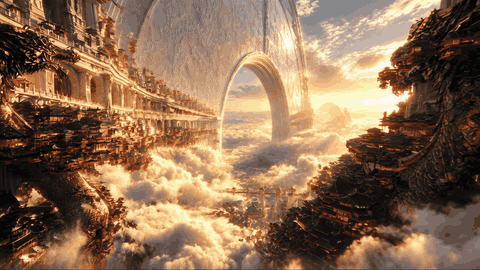
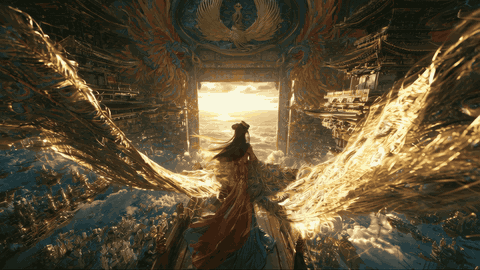

# 天宫东方美学 · 案例

本页收录2张图片与3段视频，展示云海天宫、东方巨构、光影层次与穿越镜头的视觉效果。图片保存原始文件，视频原片保存在 GitHub Release 附件中。

## 图片：凤凰天门与云海御道

原文件：`图片节点 13.png`。中轴御道通向明亮天门，两侧悬垂宫阙与上方凤凰浮雕形成框景，小人物提供尺度参照。

[查看原图](images/phoenix-gate.png)

## 图片：凤凰巨壁与云上平台

原文件：`图片节点 15.png`。巨幅凤凰宫墙沿斜向透视延伸，悬空平台、人物与远处瀑布形成前中后景，侧逆光照亮浮雕与衣料边缘。

[查看原图](images/phoenix-palace-wall.png)

## 视频：第一人称穿越成片

原文件：`智能剪辑 1 成片.mp4`。13.875秒，1920 × 1080，H.264 视频与 AAC 音轨。展示云海宫城中的第一人称飞行，近处宫阙与远处玉璧产生明显视差。

[查看或下载原视频](https://github.com/SinKry/tiangong-oriental-aesthetics/releases/download/examples-v1/edited-showcase.mp4)

## 视频：天宫 1

原文件：`天宫1.mp4`。12.064秒，2560 × 1440，HEVC 视频与 AAC 音轨。画面包含凤凰门楣、人物背影与宽幅金色织物，利用前景动态和门外亮区呈现空间张力。

[查看或下载 H.264 兼容预览版](https://github.com/SinKry/tiangong-oriental-aesthetics/releases/download/examples-v1/tiangong-01-web.mp4) · [下载原视频](https://github.com/SinKry/tiangong-oriental-aesthetics/releases/download/examples-v1/tiangong-01-original.mp4)

## 视频：天宫 2

原文件：`天宫2.mp4`。5.056秒，2560 × 1440，HEVC 视频与 AAC 音轨。画面包含月牙形巨拱、细长白玉桥、远处主殿与云海瀑布。

[查看或下载 H.264 兼容预览版](https://github.com/SinKry/tiangong-oriental-aesthetics/releases/download/examples-v1/tiangong-02-web.mp4) · [下载原视频](https://github.com/SinKry/tiangong-oriental-aesthetics/releases/download/examples-v1/tiangong-02-original.mp4)

## 素材与预览说明

- 三段原视频均按原始字节上传，不重新压制；两张PNG图片保留原文件内容。
- `天宫1`与`天宫2`另提供1920 × 1080的H.264/AAC兼容预览版，便于浏览器播放。
- GIF为各视频截取的4秒无声片段，480像素宽、6帧/秒，仅作网页动态预览，不代表原片画质。
- 海报帧位于 `posters/`，可用于案例目录封面。
- 文件规格和SHA-256校验值见 [manifest.json](manifest.json)。
- 图片与视频分别作为案例展示，不推定它们存在一一对应的生成关系。

[返回技能首页](../README.md) · [全部视频发布附件](https://github.com/SinKry/tiangong-oriental-aesthetics/releases/tag/examples-v1)
